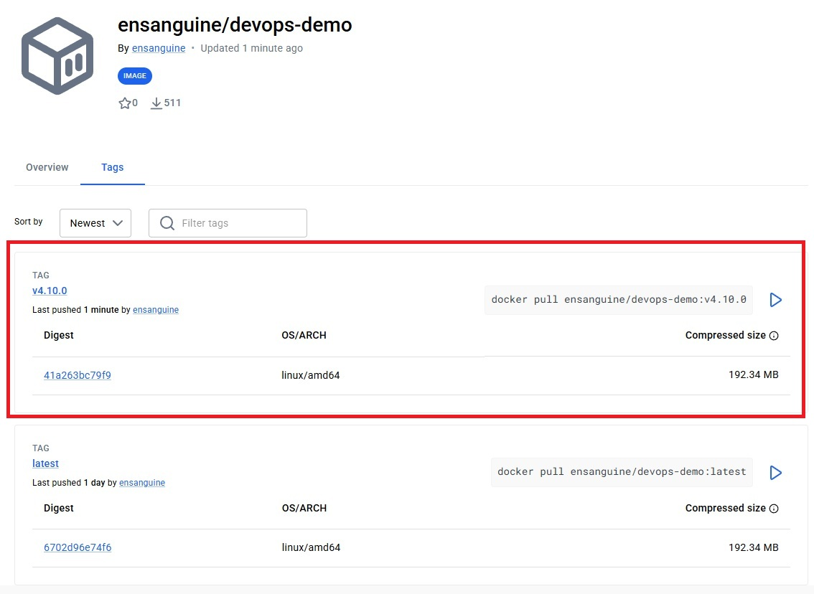
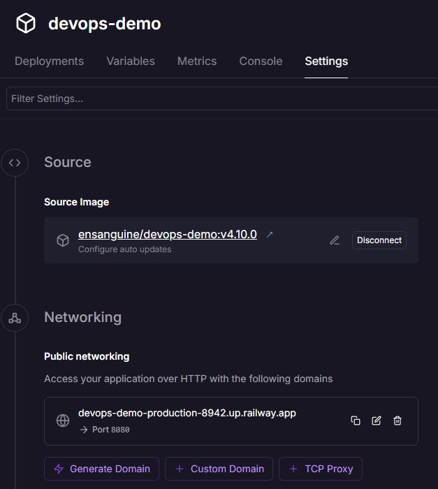
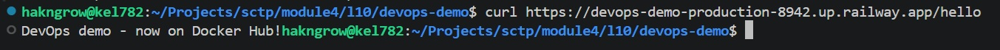

Completed devops-demo app of [Lesson 4.10: Hosting Options - Manual Hosting](https://github.com/su-ntu-sctp/ai-4.10-hosting/blob/main/lesson.md)

## Part 3 Step 1 - Build and Push the devops-demo Image 

Image of `devops-demo` pushed to DockerHub.

# Part 3 Step 3 - Deploy from Docker Hub

# Part 3 Step 6 - Test Your Application

